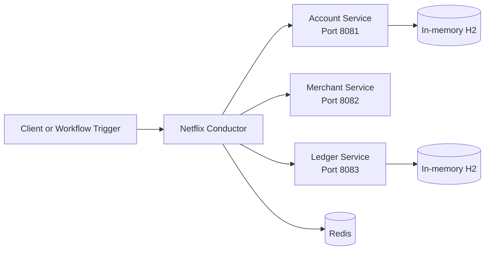

# Microservices Orchestration POC

A Java proof of concept for coordinating payment-style operations across independently running microservices, with [Netflix Conductor](https://github.com/conductor-oss/conductor) as the workflow orchestration platform.

The repository contains three Spring Boot services and a local Conductor setup. It explores transaction idempotency, service boundaries, and compensation endpoints in a distributed workflow.

> **Project status:** The services and local Conductor environment are present. The current README describes the Conductor server as ready for worker services; a fully wired, end-to-end Conductor workflow is future scope.

## Contents

- [What We Built](#what-we-built)
- [System Architecture](#system-architecture)
- [Technical Challenges and Solutions](#technical-challenges-and-solutions)
- [Results and Impact](#results-and-impact)
- [Getting Started](#getting-started)
- [Future Scope](#future-scope)

## What We Built

This proof of concept brings together:

- **Account Service** — exposes debit and compensating credit endpoints. Debit requests include basic validation, a demonstration balance check, and transaction-ID-based idempotency.
- **Merchant Service** — exposes credit and compensating debit endpoints for merchant transactions.
- **Ledger Service** — exposes an endpoint for recording ledger entries, with transaction-ID-based duplicate detection.
- **Netflix Conductor setup** — provides a local orchestration environment using Docker Compose and Redis, with a web UI for workflow management.

Each service is an independent Spring Boot application with its own Gradle build. The account and ledger services use an in-memory H2 database for their idempotency records.

## System Architecture



The intended transaction flow is:

1. Debit the customer account.
2. Credit the merchant.
3. Record the transaction in the ledger.
4. If a later step fails, invoke the relevant compensation endpoint.

The account and merchant services include compensation endpoints for credit and debit operations. These are currently proof-of-concept implementations; they log or return a demonstration response rather than performing a production-grade reversal.

### Service endpoints

| Service | Port | Endpoint | Purpose |
|---|---:|---|---|
| Account | `8081` | `POST /accounts/debit` | Debit a customer account |
| Account | `8081` | `POST /accounts/credit` | Demonstration compensation endpoint |
| Merchant | `8082` | `POST /merchants/credit` | Credit a merchant |
| Merchant | `8082` | `POST /merchants/debit` | Demonstration compensation endpoint |
| Ledger | `8083` | `POST /ledger/record` | Record a ledger entry |

## Technical Challenges and Solutions

### Building Conductor separately from the services

The services use Java 21, while the repository's local Conductor setup documents building Conductor with Java 17.

**Approach:** Build Conductor in a Java 17 environment and run the microservices with Java 21. Docker is used for the local Conductor stack to keep its supporting infrastructure separate from the service runtime.

### Handling duplicate transaction requests

Distributed workflows may retry operations after a timeout or interrupted response. Without duplicate handling, a retry could repeat a debit or ledger operation.

**Approach:** The account and ledger services use the transaction ID as an idempotency key and persist processed transaction records in H2. Repeated account debit requests return the saved response; repeated ledger entries are skipped.

### Demonstrating compensation across service boundaries

A failure after one service has completed work can leave a multi-service operation incomplete.

**Approach:** The account and merchant services expose compensating endpoints. These demonstrate where a workflow can request reversal actions. The compensation behavior is intentionally simplified and should be expanded before production use.

### Running the orchestration environment locally

A workflow engine requires supporting infrastructure, and a local setup should be straightforward to start and inspect.

**Approach:** The project uses Docker Compose for Conductor and Redis, and provides a local Conductor UI and health endpoint for verification.

## Results and Impact

The repository demonstrates the following verifiable outcomes:

- **3** independently built Spring Boot services: account, merchant, and ledger.
- **3** service ports configured: `8081`, `8082`, and `8083`.
- **2** services with H2-backed idempotency records: account and ledger.
- **5** documented HTTP endpoints across the services.
- A local Conductor setup with Redis, a web UI, and a health endpoint documented for verification.

No load-test results, throughput figures, latency measurements, or production reliability metrics are included in the repository. Such numbers should be added only after running and documenting repeatable tests.

## Getting Started

### Prerequisites

- Java 21 for the microservices
- Java 17 for building Conductor, if building it from source
- Docker Desktop with Docker Compose
- Git

Clone the repository and its Conductor submodule:

```bash
git clone --recurse-submodules https://github.com/solutionundertaken95/microservices-orchestration-poc.git
cd microservices-orchestration-poc
```

### Start Conductor

The existing local setup documents these commands for Windows PowerShell. Update `JAVA_HOME` to match the Java 17 installation on your machine.

```powershell
$env:JAVA_HOME="C:\Program Files\Java\jdk-17.0.2"
$env:PATH="$env:JAVA_HOME\bin;$env:PATH"

cd conductor
./gradlew clean build -x test

cd docker
docker compose -f docker-compose-lite.yml build
docker compose -f docker-compose-lite.yml up
```

When Conductor is running, its UI and health endpoint are available at:

- UI: <http://localhost:8080>
- Health: <http://localhost:8080/health>

### Run the services

Open a separate terminal for each service. The examples below use the Gradle wrapper included in each service directory.

```bash
cd account-service
./gradlew bootRun
```

```bash
cd merchant-service
./gradlew bootRun
```

```bash
cd ledger-service
./gradlew bootRun
```

On Windows, use `gradlew.bat bootRun` in place of `./gradlew bootRun`.

### Run service tests

Run the tests from each service directory:

```bash
./gradlew test
```

The repository includes test source sets for all three services. Check the test reports produced by Gradle for the results of a local run.

## Future Scope

- Implement Conductor workers and register them with the server.
- Define and run an end-to-end workflow for the account, merchant, and ledger operations.
- Add workflow failure handling, retry policies, timeouts, and compensation logic.
- Replace demonstration compensation responses with persistent, transaction-aware reversals.
- Replace in-memory H2 with a persistent database for development and production-like environments.
- Add integration tests that exercise the workflow across all services.
- Add API documentation, such as OpenAPI specifications.
- Add containerization and a repeatable deployment setup for the microservices.
- Establish performance and reliability baselines with documented load tests.

## License

No license is currently specified in this repository. Add a license before redistributing or reusing the project.
